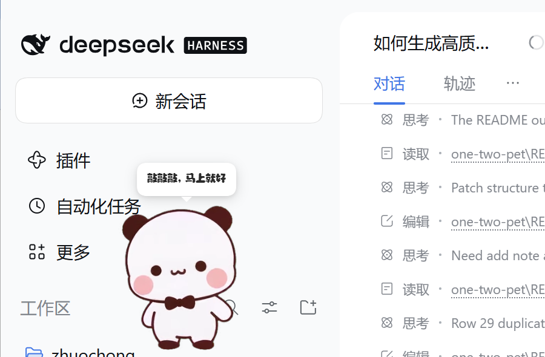
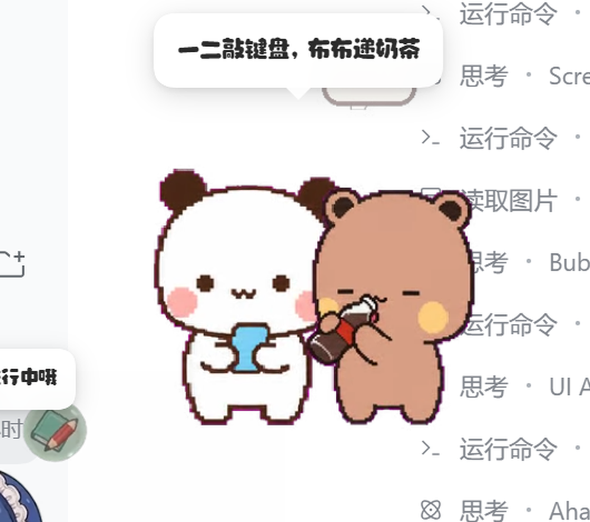
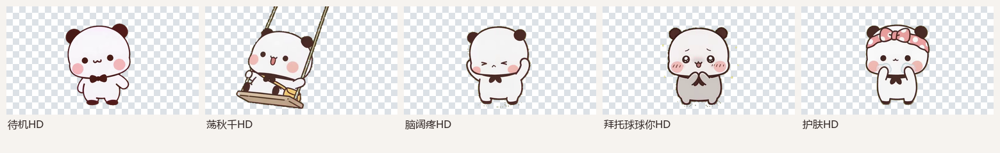

# 一二布布 · DSH 桌宠

把表情包里的 **一二**（白色圆耳朵）和 **布布**（奶茶色困困小熊）做成住在
[DeepSeek Harness](https://github.com/deepseek-ai/deepseek-harness) 里的桌宠。

本项目是一个 **dsh-pet pet pack**：复用 dsh-pet 的完整桌宠行为（待机链、点击回应、拖拽甩抛、
屏幕漫游、多宠物、右键菜单、工作状态联动、碎碎念 / 对话、桌面透明窗），只替换角色素材和动画池。
像素版会和大肥鱼一样自己呼吸、东张西望、小跑、打瞌睡、被拖起来甩出去；
现在默认的一二是 5 段 **720p 绿幕抠像**的 HD 动作，先用“待机 / 秋千 / 脑阔疼 / 拜托 / 护肤”把质感拉起来。



> 实机截图：一二 HD 在左上（现在默认只显示它；布布、像素一二、双人同框都默认隐藏）。

## 现在有什么

| 能力 | 说明 |
| --- | --- |
| 35 段像素动画 | 9 行动作图集 + 程序化小特效（爱心、Zzz、金币、气泡、问号、汗滴、月亮、红包…） |
| 5 段 HD 动画 | `yier-hd`：待机 / 荡秋千 / 脑阔疼 / 拜托球球你 / 护肤，720p 绿幕抠像，默认显示 |
| 角色 | `一二 HD`（默认）、像素 `一二`（默认隐藏）、`布布`、`一二布布`（双人同框，默认隐藏） |
| 点击回应 | 像素：元气挥手 / 开心跳跳 / 委屈巴巴 / 认真看手机 / 捧杯暖手；HD：荡秋千 / 拜托 / 脑阔疼 / 护肤 |
| 拖拽甩抛 | 悬空挣扎动画 + dsh-pet 的弹簧跟手、抛物线、屏幕反弹、落地 Q 弹（HD 版沿用物理，暂无拖拽专用姿势） |
| 自主漫游 | 像素版：小跑 / 一蹦一跳 / 欢快冲刺 / 悄悄走；HD 版暂无小跑素材，先原地待机/玩耍 |
| 工作状态 | 思考冒泡 / 忙碌敲键盘 / 清点归档 / 原地踱步 / 雀跃庆祝 / 垂头叹气冒汗 |
| 碎碎念 & 对话 | 专属人设提示词 + 表情包配图（`memes`）；自动碎碎念默认关闭，右键「碎碎念」仍可手动触发 |
| 余额动画 | 6 档（钱包鼓鼓 → 空空如也），默认关闭，可在配置里打开 |
| 多开 | 同一角色可放多只；默认只有一二 HD 显示，布布、像素一二、双人同框默认隐藏 |
| 桌面模式 | 把配置里的 `display` 改成 `both` / `desktop`，dsh-pet 会拉起透明置顶小窗 |

> 动画为 640×360 透明 VP9-alpha WebM；实际播放时透明背景，棋盘格只出现在预览图里。

## 安装

### 前置

已经装好并可用的 **dsh-pet**（本项目是它的 pet pack，不是独立插件）。当前机器上
`dsh-pet` 已通过 `link:D:/smallProject/zhuochong/dsh-pet/dsh-pet` 装在 `desktop` profile 里。

### 一条命令

在项目根目录（`one-two-pet/`）打开 PowerShell：

```powershell
powershell -ExecutionPolicy Bypass -File scripts/install.ps1
```

脚本会把这些东西复制到 `$env:USERPROFILE\.dsh\dsh-pet\pet\`：

```
yier-config.json   yier-animation\   yier-memes\
bubu-config.json   bubu-animation\   bubu-memes\
duo-config.json    duo-animation\    duo-memes\
yier-hd-config.json  yier-hd-animation\   # HD 主宠（5 段动画，默认显示）
```

然后**刷新 DSH 页面**（或右键任意宠物 →「重载配置」）。宠物默认出现位置：

- 一二 HD：左上，`size=280`，`marginX=24, marginY=160`，`display: "web"`
- 布布：默认 `display: "none"`（保留，可随时在 `bubu-config.json` 改回 `"web"`）
- 像素一二：默认 `display: "none"`（保留，可随时切回）
- 一二布布（双人）：`size=340`，默认 `display: "none"`，需要时把 `duo-config.json` 里改成 `"web"` 或 `"both"`

> 280 是照着当前大肥鱼的 `size=280` 调的；如果你把 DSH 窗口拉大或换 4K 屏，可以按比例一起调大。

### 手动安装

把 `pet/` 下的 `*-config.json`、`*-animation/`、`*-memes/` 复制到
`%USERPROFILE%\.dsh\dsh-pet\pet\` 即可；dsh-pet 每次读配置都会重新扫描该目录，不用重启 DSH。

### 卸载

```powershell
powershell -ExecutionPolicy Bypass -File scripts/install.ps1 -Uninstall
```

只删除 `yier*`、`bubu*`、`duo*` 这几组文件/目录，不碰大肥鱼和你的其他宠物。

## 切换显示哪个角色

每个 pack 的 `pets[].display` 控制显示位置：

| 值 | 含义 |
| --- | --- |
| `web` | 只显示在 DSH 网页右上/左上的 overlay 里 |
| `desktop` | 只显示在桌面透明置顶小窗里 |
| `both` | 网页 + 桌面都显示 |
| `none` | 不显示 |

想只看双人同框：把 `yier-config.json` 和 `bubu-config.json` 的 `display` 改成 `"none"`，
把 `duo-config.json` 的改成 `"web"`（或 `"both"`）。改完刷新页面或右键「重载配置」。

不想让某只自动碎碎念：把对应 `*-config.json` 的 `whisperEnabled` 改成 `false`（默认已经是 false）。
自动碎碎念每 5 分钟会给每只宠物各调一次模型；四只同开时开销不小，所以默认只保留手动触发。



`size` 是舞台宽度（px），高度按 9:16 自动算；`position.corner` 支持
`top-left` / `top-right` / `bottom-left` / `bottom-right`。

### 为什么没有「一二桌宠」的设置页？

这是 dsh-pet 的现有设计，不是配置丢了：

- DSH 设置里的「桌宠配置」只管理 **main 条目**（大肥鱼）；
- `yier-hd`、`bubu`、`duo` 都是 **pet pack（文件宠物）**，dsh-pet 明确不在设置页列出它们，
  只在页面底部提示「另 N 只额外宠物由 pet/ 目录文件定义」；
- 文件宠物的配置就是 `%USERPROFILE%\.dsh\dsh-pet\pet\<name>-config.json`，改完刷新/重载即可。

当前一二 HD 的配置在：

```text
C:\Users\ppj\.dsh\dsh-pet\pet\yier-hd-config.json
```

常用字段：

```jsonc
{
  "pets": [{
    "display": "web",          // web / desktop / both / none
    "size": 280,               // 舞台宽度
    "position": { "corner": "top-left", "marginX": 24, "marginY": 160 }
  }],
  "animations": {
    "idle": ["待机HD"],        // 改这里换待机动画
    "clicks": ["荡秋千HD", "拜托球球你HD", "脑阔疼HD", "护肤HD"]
  }
}
```

布布现在默认 `display: "none"`，想放出来就把 `bubu-config.json` 的 `display` 改回 `"web"`。
如果你想要一个真正的图形化「一二 HD 配置页」，需要额外做一个小设置面板；现有 dsh-pet 的设置页
不会列出文件宠物。

## 构建（想改素材时）

需要 Python 3 + Pillow + ffmpeg（VP9 编码器）。`build.ps1` 会自动找带 Pillow 的 Python（包括 DSH 自带运行时）：

```powershell
# ffmpeg 放在 .tools\ffmpeg.exe（.gitignore 已忽略，约 80 MB）
# 没有的话：scripts\fetch-ffmpeg.ps1（从 npm 的 ffmpeg-static 取一份）

powershell -ExecutionPolicy Bypass -File scripts\build.ps1 --packs yier --force
powershell -ExecutionPolicy Bypass -File scripts\build.ps1 --packs bubu,duo --force

# 只重新生成预览图 / 配置，不编码视频：
powershell -ExecutionPolicy Bypass -File scripts\build.ps1 --preview-only
```

脚本做三件事：

1. 从 `assets/sprites/<角色>/spritesheet.webp` 切 8×9 格（192×208/格）；
2. 按下面的动画表逐帧合成 640×360 RGBA，画上程序化小特效；
3. 用 ffmpeg 编码成 VP9-alpha WebM，并生成 `pet/<pack>-config.json`、表情包 PNG 和预览图。

## 已验证

- `GET /dsh-pet-7340/config` 返回 `main, bubu, duo, yier, yier-hd` 五个条目；三个完整 pack + HD 主宠全部通过 dsh-pet 校验
- 105 个像素动画 + 5 个 HD 动画 = 110 个 `.webm`，全部由 `/dsh-pet-7340/thumb/<pack>/<name>.webm` 以 `video/webm` 200 返回
- 5 个 HD 动画名全部通过 `POST /anim` 点播验证（待机 / 荡秋千 / 脑阔疼 / 拜托 / 护肤）
- 实机截图中一二 HD 在荡秋千、布布和大肥鱼同屏；像素一二默认隐藏
- 解码检查：640×360、24fps、`alpha_mode=1`，透明角落 alpha=0

## HD 主宠（yier-hd）

现在默认显示的一二不是像素版，而是 `yier-hd`：把 4 段新绿幕 MP4 + 之前的待机视频抠像、缩放、
编码成 640×360 VP9-alpha 的 5 段动画：

| 动画 | 来源 | 用途 |
| --- | --- | --- |
| `待机HD` | 第一段待机视频 | idle |
| `荡秋千HD` | (1).mp4 | 玩耍 / 点击回应 |
| `脑阔疼HD` | (2).mp4 | 工作出错 / 情绪 |
| `拜托球球你HD` | (3).mp4 | 点击 / 等待 |
| `护肤HD` | (4).mp4 | 小动作 / idle 轮换 |



### 替换关系

- `yier-hd` 默认 `display: "web"`，像素 `yier` 默认 `display: "none"`；布布保持显示。
- 想切回像素一二：把 `yier-config.json` 改 `"web"`、`yier-hd-config.json` 改 `"none"`，刷新/重载。
- 这 5 段都是**原地动作**，没有走路 / 拖拽 / 转向素材，所以 HD 版暂时不漫游、不换朝向；
  拖拽、抛掷、点击仍然可用。后续补一段“小跑”就可以恢复漫游。

### 导入新视频

```powershell
python scripts/import_video.py --input "C:\path\to\待机.mp4" --name "待机HD" --pack yier-hd --crop "330,20,960,710" --key-mode hsv
```

`--crop` 用于 1280×720、角色居中、四角有水印的视频；抠像参数在 `scripts/import_video.py` 的
`key_frame()` 里。新视频是**低饱和绿幕**（不是 #00FF00）时用 `--key-mode hsv`，纯亮绿幕用
`--key-mode dominance`。

## 素材来源与动画表

原始精灵图来自 [gbn666/codex-pets-bubuyier](https://github.com/gbn666/codex-pets-bubuyier)
（MIT），是 Codex 桌宠格式的 9 行动作图集：

| 行 | 状态 | 帧数 | 本项目用途 |
| --- | --- | --- | --- |
| 0 | idle | 6 | 待机、发呆、打瞌睡、数星星、摇摇晃晃、碎碎念 |
| 1 | running-right | 8 | 欢快冲刺 |
| 2 | running-left | 8 | 悄悄走 |
| 3 | waving | 4 | 元气挥手、打招呼、新年好 |
| 4 | jumping | 5 | 开心跳跳、伸懒腰、一蹦一跳、庆祝 |
| 5 | failed | 8 | 委屈巴巴、余额告急、工作出错 |
| 6 | waiting | 6 | 捧杯暖手、数金币、清点归档 |
| 7 | running | 6 | 小跑、转圈圈、原地踱步 |
| 8 | review | 6 | 认真看手机、深度思考、忙碌敲键盘、看余额 |

全部 35 段动画的名单、时长和用途见 [`docs/animations.md`](docs/animations.md)。

## 项目结构

```
one-two-pet/
├─ assets/
│  ├─ sprites/yier/spritesheet.webp      # 原始 1536×1872 图集
│  ├─ sprites/bubu/spritesheet.webp
│  └─ references/                        # 上游参考图 / 动作参考 / 许可证
├─ video/hd/                             # 5 段绿幕源视频（待机/秋千/脑阔疼/拜托/护肤）
├─ prompts/                              # 动作提示词（hd-actions / reference-image-blocks）
├─ scripts/
│  ├─ render.py                          # 切图、合成、特效、VP9 编码
│  ├─ build_pet_pack.py                  # 像素 pack：动画表 + 配置 + 预览
│  ├─ import_video.py                    # 绿幕 MP4 → 透明 WebM（HSV / dominance 抠像）
│  ├─ build_hd.ps1                       # 批量重建 5 段 HD 动画
│  ├─ check_packs.py                     # 静态校验（缺素材 / 权重 / 事件档位）
│  ├─ install.ps1                        # 安装 / 卸载到 ~/.dsh/dsh-pet/pet
│  └─ fetch-ffmpeg.ps1                   # 取一份 ffmpeg-static（可选）
├─ pet/                                  # 产物：像素 3 pack + yier-hd（5 段 HD）
├─ previews/                             # 预览图 / 动画预览页 / DSH 实机截图
└─ docs/animations.md
```

## 许可与署名

- **代码**（本仓库的脚本、配置、生成管线）：MIT。
- **一二 / 布布角色形象**：版权归原作者 / 表情包权利人所有；本项目仅作个人、非商业的
  桌面陪伴用途，不包含任何商业授权。若你是权利人并希望下架，请提 issue。
- **上游素材**：[gbn666/codex-pets-bubuyier](https://github.com/gbn666/codex-pets-bubuyier)
  （MIT），其 README 说明 `references/` 是生成后的 canonical reference，公开分发原始参考图前
  请先确认使用权。
- **运行引擎**：[PC2005-cloud/dsh-pet](https://github.com/PC2005-cloud/dsh-pet)（MIT）；
  本项目的 pet pack 复用它的行为与渲染管线，安装时请保留 dsh-pet 的署名。

## 还可以让用户帮忙做的素材

当前只有 9 行动作，够日常陪伴，但还没有大肥鱼那种“吃火锅 / 玩魔方 / 放烟花”的专属动作。
如果愿意补图，最有价值的是：

1. **新的动作行**（按 192×208/格、8 格一行、保持同一角色比例和脚底线）：
   吃东西、喝奶茶、玩手机游戏、睡觉翻身、被摸头、放烟花、中秋抱月饼、新年作揖。
2. **双人互动**：一二和布布牵手、贴贴、互相喂食、一起打伞（左右各一格）。
3. **更高分辨率**：512×554/格或 1024×1108/格，现有管线会自动缩放，边缘会更干净。
4. **点击音效**：一两声软萌“嗯？”“在呢”，wav 即可。
5. **表情包配图**：更多可用于碎碎念 / 对话气泡的 PNG（透明背景，建议 512×512 内）。

补好后放进 `assets/sprites/<角色>/` 或直接给我，我把它接进现有动画表即可。

## 故障排查

- **刷新后没出现**：确认 `%USERPROFILE%\.dsh\dsh-pet\pet\yier-config.json` 存在；
  右键任意宠物 →「重载配置」；仍然没有就看 `%USERPROFILE%\.dsh\dsh-pet\logs.txt` 里有没有
  `yier-config.json` 解析失败 / `animations` 非法。
- **出现但不动 / 空白**：检查 `yier-animation/` 下的 `.webm` 是否被复制完整；
  用 `scripts/serve_preview.ps1` 起本地预览页，确认视频本身能播。
- **想改大小/位置**：改对应 `*-config.json` 的 `pets[0].size` / `position`，刷新即可。
- **桌面模式没出现**：dsh-pet 首次启用 `desktop` 会下载 Electron；看 DSH 控制台日志。
