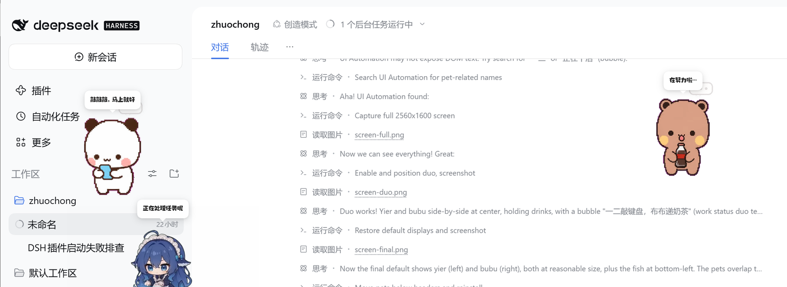
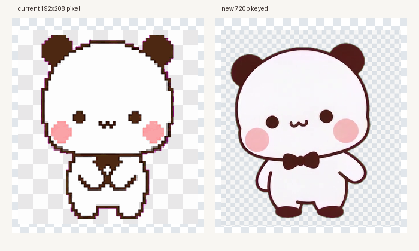
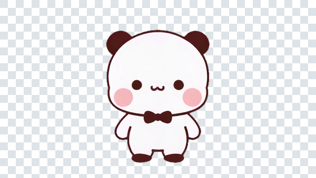

# 一二布布 · DSH 桌宠

把表情包里的 **一二**（白色圆耳朵）和 **布布**（奶茶色困困小熊）做成住在
[DeepSeek Harness](https://github.com/deepseek-ai/deepseek-harness) 里的桌宠。

本项目是一个 **dsh-pet pet pack**：复用 dsh-pet 的完整桌宠行为（待机链、点击回应、拖拽甩抛、
屏幕漫游、多宠物、右键菜单、工作状态联动、碎碎念 / 对话、桌面透明窗），只替换角色素材和动画池。
安装后，一二和布布会和大肥鱼一样，自己呼吸、东张西望、小跑、打瞌睡、被拖起来甩出去。



> 实机截图：左一二、右布布，下面是大肥鱼；三只共用一套 dsh-pet 引擎。

## 现在有什么

| 能力 | 说明 |
| --- | --- |
| 35 段动画 | 9 行动作图集 + 程序化小特效（爱心、Zzz、金币、气泡、问号、汗滴、月亮、红包…） |
| 角色 | `一二`、`布布`、`一二布布`（双人同框）三个独立 pet pack |
| 点击回应 | 元气挥手 / 开心跳跳 / 委屈巴巴 / 认真看手机 / 捧杯暖手 |
| 拖拽甩抛 | 悬空挣扎动画 + dsh-pet 的弹簧跟手、抛物线、屏幕反弹、落地 Q 弹 |
| 自主漫游 | 小跑 / 一蹦一跳 / 欢快冲刺 / 悄悄走，真实位移，不走出屏幕 |
| 工作状态 | 思考冒泡 / 忙碌敲键盘 / 清点归档 / 原地踱步 / 雀跃庆祝 / 垂头叹气冒汗 |
| 碎碎念 & 对话 | 专属人设提示词 + 表情包配图（`memes`）；自动碎碎念默认关闭，右键「碎碎念」仍可手动触发 |
| 余额动画 | 6 档（钱包鼓鼓 → 空空如也），默认关闭，可在配置里打开 |
| 多开 | 同一角色可放多只；默认一二在左上、布布在右上，双人同框默认隐藏 |
| 桌面模式 | 把配置里的 `display` 改成 `both` / `desktop`，dsh-pet 会拉起透明置顶小窗 |
| HD 样片 | 一段 720p 绿幕视频抠像后的 `待机HD`，放在 `yier-hd` 样片包里，默认隐藏，用来对比质感 |

> 动画为 640×360 透明 VP9-alpha WebM；实际播放时透明背景，棋盘格只出现在预览图里。

## 安装

### 前置

已经装好并可用的 **dsh-pet**（本项目是它的 pet pack，不是独立插件）。当前机器上
`dsh-pet` 已通过 `link:D:/smallProject/zhuochong/dsh-pet/dsh-pet` 装在 `desktop` profile 里。

### 一条命令

在项目根目录（`one-two-pet/`）打开 PowerShell：

```powershell
powershell -ExecutionPolicy Bypass -File scripts/install.ps1
```

脚本会把这些东西复制到 `$env:USERPROFILE\.dsh\dsh-pet\pet\`：

```
yier-config.json   yier-animation\   yier-memes\
bubu-config.json   bubu-animation\   bubu-memes\
duo-config.json    duo-animation\    duo-memes\
yier-hd-config.json  yier-hd-animation\   # 可选 HD 样片，默认 display: none
```

然后**刷新 DSH 页面**（或右键任意宠物 →「重载配置」）。宠物默认出现位置：

- 一二：左上，`size=280`，`marginX=24, marginY=160`
- 布布：右上，`size=280`，`marginX=24, marginY=160`
- 一二布布（双人）：`size=340`，默认 `display: "none"`，需要时把 `duo-config.json` 里改成 `"web"` 或 `"both"`

> 280 是照着当前大肥鱼的 `size=280` 调的；如果你把 DSH 窗口拉大或换 4K 屏，可以按比例一起调大。

### 手动安装

把 `pet/` 下的 `*-config.json`、`*-animation/`、`*-memes/` 复制到
`%USERPROFILE%\.dsh\dsh-pet\pet\` 即可；dsh-pet 每次读配置都会重新扫描该目录，不用重启 DSH。

### 卸载

```powershell
powershell -ExecutionPolicy Bypass -File scripts/install.ps1 -Uninstall
```

只删除 `yier*`、`bubu*`、`duo*` 这几组文件/目录，不碰大肥鱼和你的其他宠物。

## 切换显示哪个角色

每个 pack 的 `pets[].display` 控制显示位置：

| 值 | 含义 |
| --- | --- |
| `web` | 只显示在 DSH 网页右上/左上的 overlay 里 |
| `desktop` | 只显示在桌面透明置顶小窗里 |
| `both` | 网页 + 桌面都显示 |
| `none` | 不显示 |

想只看双人同框：把 `yier-config.json` 和 `bubu-config.json` 的 `display` 改成 `"none"`，
把 `duo-config.json` 的改成 `"web"`（或 `"both"`）。改完刷新页面或右键「重载配置」。

不想让某只自动碎碎念：把对应 `*-config.json` 的 `whisperEnabled` 改成 `false`（默认已经是 false）。
自动碎碎念每 5 分钟会给每只宠物各调一次模型；四只同开时开销不小，所以默认只保留手动触发。


`size` 是舞台宽度（px），高度按 9:16 自动算；`position.corner` 支持
`top-left` / `top-right` / `bottom-left` / `bottom-right`。

## 构建（想改素材时）

需要 Python 3 + Pillow + ffmpeg（VP9 编码器）。`build.ps1` 会自动找带 Pillow 的 Python（包括 DSH 自带运行时）：

```powershell
# ffmpeg 放在 .tools\ffmpeg.exe（.gitignore 已忽略，约 80 MB）
# 没有的话：scripts\fetch-ffmpeg.ps1（从 npm 的 ffmpeg-static 取一份）

powershell -ExecutionPolicy Bypass -File scripts\build.ps1 --packs yier --force
powershell -ExecutionPolicy Bypass -File scripts\build.ps1 --packs bubu,duo --force

# 只重新生成预览图 / 配置，不编码视频：
powershell -ExecutionPolicy Bypass -File scripts\build.ps1 --preview-only
```

脚本做三件事：

1. 从 `assets/sprites/<角色>/spritesheet.webp` 切 8×9 格（192×208/格）；
2. 按下面的动画表逐帧合成 640×360 RGBA，画上程序化小特效；
3. 用 ffmpeg 编码成 VP9-alpha WebM，并生成 `pet/<pack>-config.json`、表情包 PNG 和预览图。

## 已验证

- `GET /dsh-pet-7340/config` 返回 `main, bubu, duo, yier, yier-hd` 五个条目；三个完整 pack + 一个 HD 样片全部通过 dsh-pet 校验
- 105 个像素动画 + 1 个 HD 样片全部由 `/dsh-pet-7340/thumb/<pack>/<name>.webm` 以 `video/webm` 200 返回
- 实机截图中一二、布布、大肥鱼同屏；双人包通过 `pet-display` 切到 `web` 后验证，再切回默认
- 点击一二能触发点击回应动画；工作状态气泡会跟随当前 DSH 会话显示
- 解码检查：640×360、24fps、`alpha_mode=1`，透明角落 alpha=0

## HD 样片（可选）

`yier-hd` 是一个单动作样片：把 720p 绿幕 MP4 抠像、缩放、编码成 640×360 VP9-alpha 的 `待机HD.webm`。
默认 `display: "none"`；想看对比就把 `yier-hd-config.json` 的 `display` 改成 `"web"`。





导入新视频：

```powershell
python scripts/import_video.py --input "C:\path\to\待机.mp4" --name "待机HD" --pack yier-hd
```

`--crop` 默认是 `330,20,960,710`，用于 1280×720、角色居中、四角有"豆包 AI 生成"水印的视频；
换分辨率或构图时请先调 `--crop`。抠像参数在 `scripts/import_video.py` 的 `key_frame()` 里。

## 素材来源与动画表

原始精灵图来自 [gbn666/codex-pets-bubuyier](https://github.com/gbn666/codex-pets-bubuyier)
（MIT），是 Codex 桌宠格式的 9 行动作图集：

| 行 | 状态 | 帧数 | 本项目用途 |
| --- | --- | --- | --- |
| 0 | idle | 6 | 待机、发呆、打瞌睡、数星星、摇摇晃晃、碎碎念 |
| 1 | running-right | 8 | 欢快冲刺 |
| 2 | running-left | 8 | 悄悄走 |
| 3 | waving | 4 | 元气挥手、打招呼、新年好 |
| 4 | jumping | 5 | 开心跳跳、伸懒腰、一蹦一跳、庆祝 |
| 5 | failed | 8 | 委屈巴巴、余额告急、工作出错 |
| 6 | waiting | 6 | 捧杯暖手、数金币、清点归档 |
| 7 | running | 6 | 小跑、转圈圈、原地踱步 |
| 8 | review | 6 | 认真看手机、深度思考、忙碌敲键盘、看余额 |

全部 35 段动画的名单、时长和用途见 [`docs/animations.md`](docs/animations.md)。

## 项目结构

```
one-two-pet/
├─ assets/
│  ├─ sprites/yier/spritesheet.webp      # 原始 1536×1872 图集
│  ├─ sprites/bubu/spritesheet.webp
│  └─ references/                        # 上游参考图 / 许可证（署名用）
├─ scripts/
│  ├─ render.py                          # 切图、合成、特效、VP9 编码
│  ├─ build_pet_pack.py                  # 动画表 + 配置生成 + 预览
│  ├─ install.ps1                        # 安装 / 卸载到 ~/.dsh/dsh-pet/pet
│  └─ fetch-ffmpeg.ps1                   # 取一份 ffmpeg-static（可选）
├─ pet/                                  # 产物：3 个 pack + 动画 + 表情包
├─ previews/                             # 预览图 / 动画预览页
└─ docs/animations.md
```

## 许可与署名

- **代码**（本仓库的脚本、配置、生成管线）：MIT。
- **一二 / 布布角色形象**：版权归原作者 / 表情包权利人所有；本项目仅作个人、非商业的
  桌面陪伴用途，不包含任何商业授权。若你是权利人并希望下架，请提 issue。
- **上游素材**：[gbn666/codex-pets-bubuyier](https://github.com/gbn666/codex-pets-bubuyier)
  （MIT），其 README 说明 `references/` 是生成后的 canonical reference，公开分发原始参考图前
  请先确认使用权。
- **运行引擎**：[PC2005-cloud/dsh-pet](https://github.com/PC2005-cloud/dsh-pet)（MIT）；
  本项目的 pet pack 复用它的行为与渲染管线，安装时请保留 dsh-pet 的署名。

## 还可以让用户帮忙做的素材

当前只有 9 行动作，够日常陪伴，但还没有大肥鱼那种“吃火锅 / 玩魔方 / 放烟花”的专属动作。
如果愿意补图，最有价值的是：

1. **新的动作行**（按 192×208/格、8 格一行、保持同一角色比例和脚底线）：
   吃东西、喝奶茶、玩手机游戏、睡觉翻身、被摸头、放烟花、中秋抱月饼、新年作揖。
2. **双人互动**：一二和布布牵手、贴贴、互相喂食、一起打伞（左右各一格）。
3. **更高分辨率**：512×554/格或 1024×1108/格，现有管线会自动缩放，边缘会更干净。
4. **点击音效**：一两声软萌“嗯？”“在呢”，wav 即可。
5. **表情包配图**：更多可用于碎碎念 / 对话气泡的 PNG（透明背景，建议 512×512 内）。

补好后放进 `assets/sprites/<角色>/` 或直接给我，我把它接进现有动画表即可。

## 故障排查

- **刷新后没出现**：确认 `%USERPROFILE%\.dsh\dsh-pet\pet\yier-config.json` 存在；
  右键任意宠物 →「重载配置」；仍然没有就看 `%USERPROFILE%\.dsh\dsh-pet\logs.txt` 里有没有
  `yier-config.json` 解析失败 / `animations` 非法。
- **出现但不动 / 空白**：检查 `yier-animation/` 下的 `.webm` 是否被复制完整；
  用 `scripts/serve_preview.ps1` 起本地预览页，确认视频本身能播。
- **想改大小/位置**：改对应 `*-config.json` 的 `pets[0].size` / `position`，刷新即可。
- **桌面模式没出现**：dsh-pet 首次启用 `desktop` 会下载 Electron；看 DSH 控制台日志。
